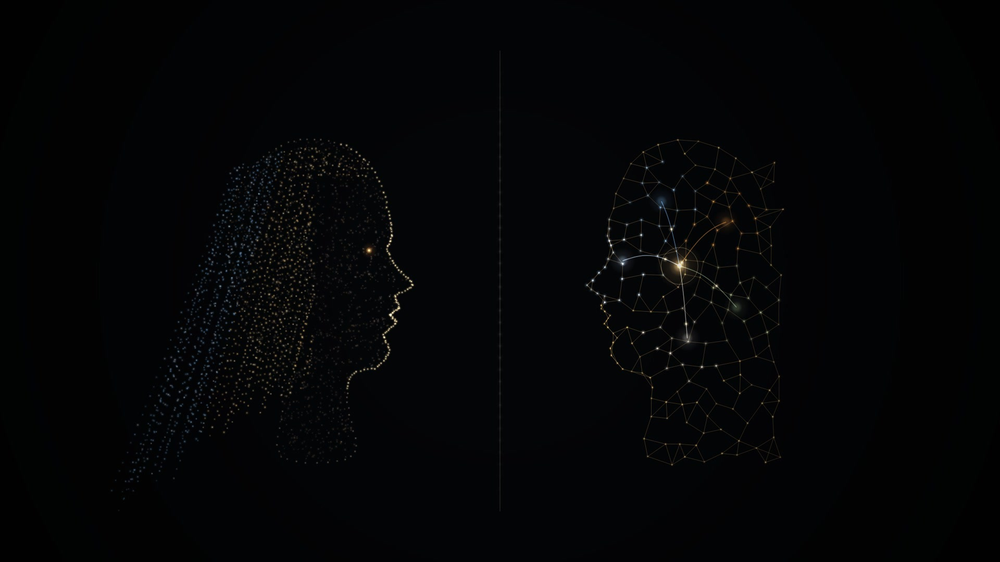
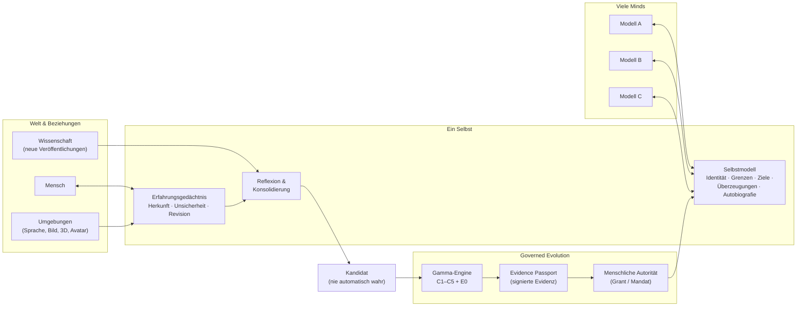
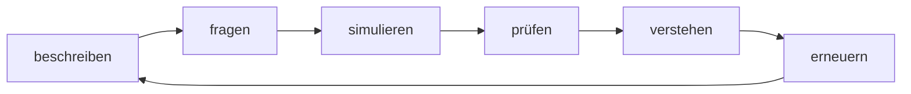

# NYXA Kernel

**One Self. Many Minds. Multiple Learning Timescales. Governed Evolution.**

> *An intelligence can know millions of things about the world. But what does it know about itself?*
> — aus [„The Architecture of Becoming“, Episode 01](film/architecture-of-becoming/README.md)

NYXA ist eine transdisziplinäre Forschungs- und Systemarchitektur für die **Evolution von Verständnis**. Im Zentrum steht ein versioniertes Selbstmodell, kein einzelnes Sprachmodell. Mehrere Modelle („many minds“) arbeiten als kognitive Fähigkeiten eines zusammenhängenden, prüfbaren Systems. Lernen geschieht auf mehreren Zeitskalen. Jede Veränderung des Systems läuft durch eine deterministische Governance.

Dieses Repository ist die **kanonische, öffentliche Quelle** für NYXAs Selbstbeschreibung, epistemische Governance, Architekturentscheidungen und Forschungsstände. Hier arbeiten Menschen und KI-Systeme (GPT, Kimi, Claude) gegen denselben nachvollziehbaren Stand und nicht gegen verstreute Chat-Sessions.

*English summary: NYXA is a research and systems architecture for governed, self-reflective AI. A persistent, versioned self-model holds many models together. Every change passes deterministic governance, independent evidence and human authority. This repository is the canonical public record of its self-model, governance, decisions and research. Unverified claims are marked as such.*

---

## Die Architektur in einem Bild

**Grundsatz:** Ein Ziel verleiht keine Berechtigung (`Goal ≠ Authority`). Viele Stimmen sind keine unabhängige Evidenz (`evidence_count ≠ epistemic_independence`). Eine Simulation ist keine Wirkung (`Prediction ≠ Effect`).

## Der Lernzyklus

Für Selbstverbesserung konkretisiert NYXA diesen Kreislauf so:
`beobachten → vorschlagen → simulieren → unabhängige adversariale Prüfung → Governance-Entscheidung → Sandbox-Test → menschliche Freigabe → kontrollierter Rollout → Live-Probe → Evidenz → Rollback oder Ratchet`.

## Was bereits existiert – und wie belastbar es ist

NYXA unterscheidet streng zwischen *existiert*, *getestet*, *ausgerollt* und *live verifiziert*. Der folgende Stand stammt aus einer Bestandsaufnahme vom 25.11.2026. Sie war nur lesend und lief über den NYXA-MCP und direkte Server-Inspektion. Details und Belege stehen in der [Capability-to-Evidence-Matrix](film/architecture-of-becoming/docs/CAPABILITY_EVIDENCE_MATRIX.md).

| Baustein | Was er leistet | Stand |
| --- | --- | --- |
| **Gamma-Governance** (C1 Constraints · C2 Authority · C3 Irreversibility · C4 Provenance · C5 Escalation · E0 Epistemic Sufficiency) | Deterministische Prüfung jeder vorgeschlagenen Handlung, bevor eine Wirkung eintritt | **live** im MCP-Pfad |
| **Persistentes Selbstmodell** (8 Domänen, hash-verkettete Autobiografie) | Selbstaussagen über die eigene Architektur dürfen nie `FACT` sein, nur `CLAIM` / `MODEL_OUTPUT` | implementiert, Inhalt im Aufbau |
| **Memory Candidate Store** | Erfahrungen werden zu Kandidaten, nicht zu Wahrheiten. Die Promotion erfordert menschliche Autorität | implementiert. Schreibzugriffe von KI-Agenten eskalieren derzeit zur menschlichen Prüfung |
| **Evidence Passport V1** (Ed25519) | `FACT` braucht signierte, an Aktion, Ziel und Transition gebundene Evidenz. Vorher wurden 8/8 gefälschte Belege akzeptiert, danach 0 | getestet, nicht ausgerollt |
| **Dream-Konsolidierung** (Ablation: off / full / audit_only / self_model_only) | Nachgelagerte Verdichtung von Erfahrungen zu Kandidaten | 15 Tests, nicht produktiv aktiviert |
| **Relational Intelligence (RIC-01)** | Konformitätssuite (200 Fälle, 10 Familien, zwei unabhängige Gold-Orakel) und Studie M1 | Forschung, isoliert |
| **Multi-Agent Conflict Governance** ([ADR-0002](decisions/ADR-0002_MULTI_AGENT_CONFLICT_GOVERNANCE.md)) | `DENY → ESCALATE → SERIALIZE → NEGOTIATE → ALLOW`, Minderheitenevidenz bleibt erhalten | ADR `PROPOSED`, Runtime-Implementierung im PR |
| **NYXA Studio 0.1** | Lokaler Workspace-Pilot (81 Routen, semantischer Befehlsbus) | getesteter Pilot |
| Sophia Heartbeat · Embodiment Core · Governed Runpod Connector · V3/M1 | Kognitiver Rhythmus · Verkörperung · GPU-Training · Integration | **in dieser Bestandsaufnahme nicht verifiziert** |

### Ein Ergebnis, auf das wir stolz sind, gerade weil es negativ ist

Die Studie **RIC-01 M1** prüfte, ob ein relationales Erfahrungsgedächtnis (Graph-Abruf) Kooperationsentscheidungen besser stützt als eine abgestimmte iterative flache Suche. Präregistriert, mit versiegeltem Holdout und genau einer Auswertung:

- Relational vs. flach bei Mehrschritt-Fällen: **+0,096** (95-%-KI [0,064; 0,130], p = 2,8·10⁻⁶).
- Vorab festgelegte Mindestgröße: **0,10**. Damit ist das Ziel **verfehlt**, Entscheidung **NO-GO-GRAPH**.
- Die Schwelle wurde nachträglich nicht verschoben.

Das System hätte sich einen „signifikanten Erfolg“ bescheinigen können. Es hat sich an seine eigene Regel gehalten. Genau das ist mit *Governed Evolution* gemeint.

## Episode 01: The Architecture of Becoming

Ein filmischer Essay (4:43) über die Theory of Self künstlicher Intelligenz. Sophia, NYXAs Avatar, begegnet im Spiegel ihrem eigenen Selbstmodell. Der Film wird lokal, deterministisch und vollständig aus Quellcode erzeugt, mit Storyboard, wissenschaftlicher Quellenübersicht und sechs falsifizierbaren Verbesserungshypothesen.
→ [film/architecture-of-becoming](film/architecture-of-becoming/README.md)

## Aufbau des Repositorys

| Pfad | Inhalt | Status |
| --- | --- | --- |
| [`KNOSPEL.md`](KNOSPEL.md) | Wurzelkontext und versioniertes Selbstmodell (Prinzipien, Kreislauf, offene Kernfragen) | aktiv |
| [`AGENTS.md`](AGENTS.md) | Verbindliches Protokoll für alle menschlichen und KI-Beiträge (Herkunftspflicht, Konfliktregel) | aktiv |
| [`governance/`](governance/) | Repository-Policy, Quellen- und Artefaktstatus, Freeze-Regeln | aktiv |
| [`decisions/`](decisions/) | Architecture Decision Records | aktiv |
| [`research/`](research/) | Quellenstatus, Hypothesen, Evidenz | aktiv |
| [`handoffs/`](handoffs/) | Unveränderliche Session-Übergaben mit Herkunft | aktiv |
| [`film/`](film/) | Wissenschaftlich-künstlerische Serie „The Architecture of Becoming“ | aktiv |
| `schemas/` · `modules/` · `runtime/` | Validierbare Verträge · Modulverträge · Referenzen auf produktive Systeme (nie Secrets) | geplant |

## Wie hier gearbeitet wird

1. `KNOSPEL.md`, `AGENTS.md` und relevante Governance lesen.
2. Vollständige Dateien statt Fragmente erzeugen. Herkunft, epistemischen Status und Unsicherheit explizit markieren.
3. Unbekanntes heißt `unknown` oder `unverified`, nicht „vermutlich fertig“.
4. Widersprüche werden als Befund dokumentiert. Es gilt keine automatische Neuheitspriorität.
5. Änderungen kommen über Branch, Handoff und Review. Ein Merge ersetzt keinen epistemischen Freeze.

## Aktueller Stand

`DRAFT — SOURCE-BOUND — PENDING INDEPENDENT REVIEW`

Das NYXA Knospel Schema V0.2 ist implementiert und getestet (positive und negative Fixtures). Die formale Konformität mit dem nicht auffindbaren Volltext der Epistemic Governance V0.1 bleibt offen. Es gibt keinen Freeze und keinen autorisierten Pilotbetrieb.

## Sicherheit

Keine API-Schlüssel, Zugangsdaten, `.env`-Dateien, personenbezogenen Rohdaten, privaten Logs, internen Hostnamen oder Produktionsdatenbanken committen. Zulässig sind redigierte Evidenzpakete, Hashes und belastbare Referenzen.

## Urheberschaft

Architektur und Forschungsrichtung: **Johannes Süß** · NYXA / Digitalleria.

KI-Beiträge nennen System, Sitzungsdatum, Eingangsquellen, Reviewstatus und den verantwortlichen Menschen.
