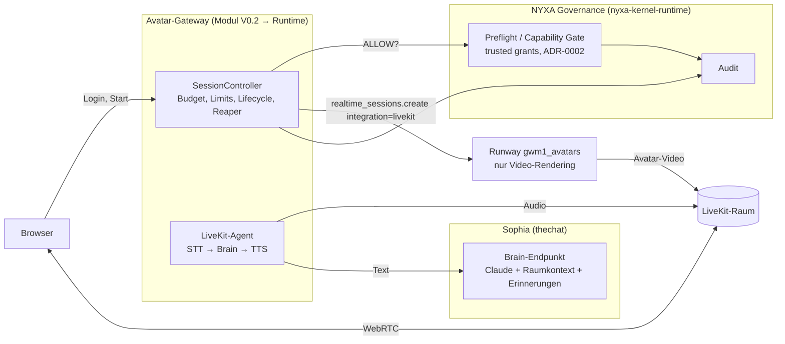
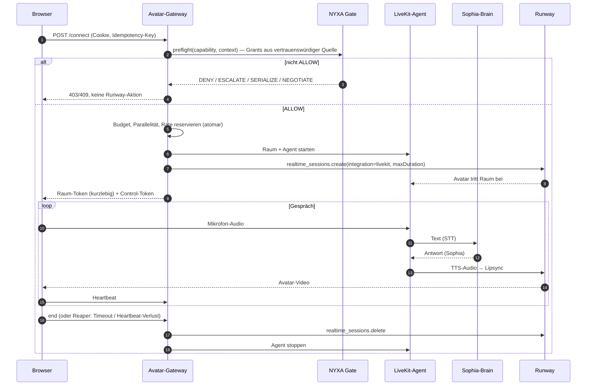

# ADR-0004: Avatar-Schicht für Sophia / The Room — Variantenvergleich und Zielarchitektur

**Status:** `PROPOSED`
**Datum:** 2026-11-06 (Europe/Berlin)
**Entscheider:** Johannes Süß
**Verfasst von:** Claude Code (Anthropic), Cloud-Session, im Auftrag von Johannes Süß
**Quellenstatus:** `SOURCE-BOUND`, siehe Quellenliste. Alle Runway-Aussagen beruhen auf Dokumentation und
SDK-Typdefinitionen, **nicht** auf beobachtetem Live-Verhalten.
**Reviewstatus:** `PENDING INDEPENDENT REVIEW`
**Vorgänger:** ADR-0002 (Governance), ADR-0003 (Ablage)

## 1. Leitprinzip (Zielmodell, keine bestätigte Realität)

> NYXA verwaltet Governance. Sophia verwaltet die Konversation. Die Avatar-Schicht stellt sie dar.

Die frühere Aussage „Runway Characters ist als reine visuelle Avatar-Schicht für Sophia verwendbar“ war eine
Architekturhypothese. Ergebnis dieser Prüfung: Die Trennung ist **dokumentiert** (zwei Integrationsmodi), aber
**nicht live verifiziert** und **nicht** in der Form „Sophia schickt Text, Avatar spricht ihn“.

## 2. Quellen

| Quelle | Stand | Status |
| --- | --- | --- |
| `@runwayml/sdk` 4.24.0, `resources/realtime-sessions.d.ts`, `avatars.d.ts`, `avatar-conversations.d.ts` | installiert 2026-11-06 | SOURCE-VERIFIED (Typen), Verhalten UNVERIFIED |
| `@runwayml/avatars` 0.17.0, `dist/api.d.ts` (`consumeSession`, `createElevenLabsSession`) | installiert 2026-11-06 | SOURCE-VERIFIED (Typen) |
| `https://docs.dev.runwayml.com/_llms-txt/characters.txt`, SHA-256 `b1d7eb7b…f81a` | gelesen 2026-11-06 | SOURCE-BOUND |
| `https://docs.dev.runwayml.com/guides/pricing.md`, SHA-256 `62146f88…046` | gelesen 2026-11-06 | SOURCE-BOUND |
| `Johannesalchemist/thechat` `7aaa471` (Sophia / The Room) | geklont 2026-11-06 | SOURCE-VERIFIED (Code), Produktionsstand UNKNOWN |

## 3. Bestandsaufnahme Sophia / The Room (`thechat` @ `7aaa471`)

| Baustein | Befund | Status |
| --- | --- | --- |
| Conversation-Brain | `apps/console/api/server.js`: `POST /api/room/message` (Orchestrator wählt 1–3 Agenten, Sophia = `ROOM_AGENTS.sophia`) und `POST /api/chat` (1:1). LLM-Aufruf über Anthropic Messages API (im Code: `claude-sonnet-4-6`). | SOURCE-VERIFIED |
| Zustand / Kontext | Raumverlauf im Speicher (`roomHistory`, geht beim Neustart verloren), letzte 14 Nachrichten als Kontext; persistente Nutzererinnerungen über `getUserMemories()` / `distillMemories()`. | SOURCE-VERIFIED |
| Persönlichkeit | Systemprompt-String pro Agent in `ROOM_AGENTS`. | SOURCE-VERIFIED |
| Sprachsynthese | `POST /api/tts` → ElevenLabs `eleven_turbo_v2_5`, feste Voice-ID je Agent. | SOURCE-VERIFIED |
| Spracheingabe | Browser Web Speech API (`room.html`, `SpeechRecognition`). | SOURCE-VERIFIED |
| OpenAI Realtime | **Nicht gefunden** (repo-weite Suche). `apps/api/llm/openai.js` ist syntaktisch defekt (Escape-Fehler). | SOURCE-VERIFIED (Abwesenheit im Repo) |
| LiveKit | **Nicht gefunden.** | SOURCE-VERIFIED (Abwesenheit) |
| Avatar / Video | Keine Echtzeit-Avatarausgabe; `apps/api/video/` nutzt Runway nur für Videogenerierung. | SOURCE-VERIFIED |
| NYXA Capability Gates | Kein Aufruf von `nyxa-kernel-runtime`-Preflight in `thechat` gefunden. | SOURCE-VERIFIED (Abwesenheit) |
| Produktionsstand | Ob `7aaa471` dem laufenden System entspricht, ist nicht attestiert. | UNKNOWN |

## 4. Runway-Fähigkeiten (dokumentiert)

| Fähigkeit | Fundstelle | Status |
| --- | --- | --- |
| Runway-eigene Konversation (Modell, Stimme, Persönlichkeit, Wissensdokumente) | `POST /v1/realtime_sessions` | dokumentiert, UNVERIFIED live |
| `personality` / `startScript` pro Session überschreiben | SDK `RealtimeSessionCreateParams` | dokumentiert |
| Tools: `client_event` (an Browser), `backend_rpc` (Rundreise zu eigenem Backend) | SDK | dokumentiert |
| `integration: { type: "elevenlabs", signedUrl }`: ElevenLabs-Agent führt STT/LLM/TTS, Runway rendert | SDK + Doku „ElevenLabs Agents“ | dokumentiert; nur mit **eigenem (custom) Avatar** |
| `integration: { type: "livekit", url, token, roomName }`: eigener LiveKit-Agent liefert Audio, Runway publiziert Video | SDK + Doku „LiveKit Agents“ | dokumentiert |
| `personality`, `startScript`, `tools` gemeinsam mit `integration` | Doku-Troubleshooting: „cannot be used with integration“ | **UNSUPPORTED** |
| Text direkt an den Echtzeit-Avatar senden („sprich diesen Satz“) | in SDK 4.24.0 / avatars 0.17.0 nicht gefunden | **UNSUPPORTED** (soweit Typen reichen) |
| Nicht-echtzeitfähiges Avatarvideo aus Text (`POST /v1/avatar_videos`) | Preisliste | dokumentiert, asynchron, nicht dialogfähig |
| Einmal nutzbare Session-Credentials | Doku „One-time consume“ | dokumentiert, **UNVERIFIED** |
| Transkript + Aufnahme abrufen / löschen | `avatarConversations.retrieve/delete` | dokumentiert, UNVERIFIED |
| Nutzungsstatistik | `avatars.getUsage` | dokumentiert |
| Preis Echtzeit | 2 Credits sofort + 2 Credits je 6 s (≈ 20 Credits/min; 1 Credit = 0,01 USD) | SOURCE-BOUND |

## 5. Variantenvergleich

Kosten: nur Runway-Anteil aus der Preisliste; übrige Anbieter `UNKNOWN` (nicht recherchiert, keine Annahme).

| Kriterium | A: Runway-native | B: Runway + Sophia-Brain | C: Sophia + vorhandene Pipeline |
| --- | --- | --- | --- |
| Schnittstellen | `realtime_sessions` + `personality` | `integration: livekit` (empfohlen) oder `integration: elevenlabs` | bestehende `/api/room/message`, `/api/tts`, Web Speech |
| Kontrolle über Sprache/Dialog | gering: Runway-Modell; Sophia nur als Persönlichkeitstext | hoch (LiveKit: eigener STT/LLM/TTS-Agent); bei ElevenLabs-Modus liegt der Dialog beim ElevenLabs-Agenten | voll |
| Persönlichkeit/Kontextkontinuität | Raumverlauf, Erinnerungen und Orchestrator gehen verloren; nur Prompt + Wissensdokumente | erhalten, wenn der LiveKit-Agent Sophias bestehenden Brain-Endpunkt aufruft | erhalten |
| Latenz | ein Anbieter, vermutlich am niedrigsten — UNVERIFIED | zusätzliche Hops (STT → Claude → TTS → Runway-Lipsync) — UNVERIFIED | heute: Turn-basiert (Text → TTS-Datei), keine Echtzeit |
| Kosten | ≈ 20 Credits/min Runway | ≈ 20 Credits/min Runway + LLM + TTS + STT + LiveKit (UNKNOWN) | LLM + TTS wie heute; kein Video |
| Datenschutz | Audio, Transkript, Aufnahme bei Runway | Runway + LiveKit + STT/TTS-Anbieter + Anthropic | Anthropic + ElevenLabs + Browser-STT-Anbieter |
| Skalierbarkeit | Runway-Tier-Limits (Doku „tiers“), UNVERIFIED | zusätzlich LiveKit-Agentenbetrieb | wie heute |
| Herstellerabhängigkeit | hoch (Brain + Avatar bei Runway) | mittel (nur Darstellung bei Runway, austauschbar) | gering |
| Unsicherheiten | Deutschsprachigkeit, Wissensdokumente, Prompt-Treue | LiveKit-Betrieb neu; Runway-Lipsync mit fremdem Audio nicht live geprüft; Gesamtlatenz | kein Avatar |

## 6. Entscheidung (Vorschlag)

1. **Zielarchitektur: Variante B über `integration: livekit`.** Sie ist die einzige dokumentierte Form, in der
   Sophia (bestehender Brain-Endpunkt, bestehende ElevenLabs-Stimme) die Konversation behält und Runway nur
   darstellt. Status: Zielbild, `UNVERIFIED`.
2. **Produktiv bleibt Variante C** unverändert, bis B in einem isolierten Spike nachgewiesen ist.
3. **Variante A** nur als isolierter Demo- und Messaufbau (Modul V0.2), nicht als Sophia.
4. **Keine Sophia-Code-Änderung in V0.2.** Grund: Die Schnittstelle (LiveKit-Agent ↔ Sophia-Brain) existiert noch
   nicht, und `thechat` ist nicht Teil der Autorisierung. Die Änderung wäre weder bestätigt noch reversibel
   vorbereitet.

## 7. Zielarchitektur (Variante B)

### Komponenten

### Ablauf

## 8. Nichtentscheidung

- Keine Wahl eines LiveKit-Betriebsmodells (Cloud oder selbst gehostet).
- Kein Pilotbetrieb, keine Nutzung mit Minderjährigen.
- Kein Ersatz bestehender TTS-/LLM-Anbieter.

## 9. Nächster zulässiger Schritt

1. Freigabe des isolierten Live-Tests der Variante A (siehe
   `modules/runway-dev-characters/docs/LIVE_TEST_PROTOCOL_V0.2.md`), um Session-Lifecycle, Kosten und
   One-time-Consume real zu beobachten.
2. Danach separat freizugebender Spike B: LiveKit-Agent mit **statischem** Testtext statt Sophia-Brain, um
   Runway-Lipsync mit fremdem Audio nachzuweisen. Erst danach Anbindung an den Brain-Endpunkt.
