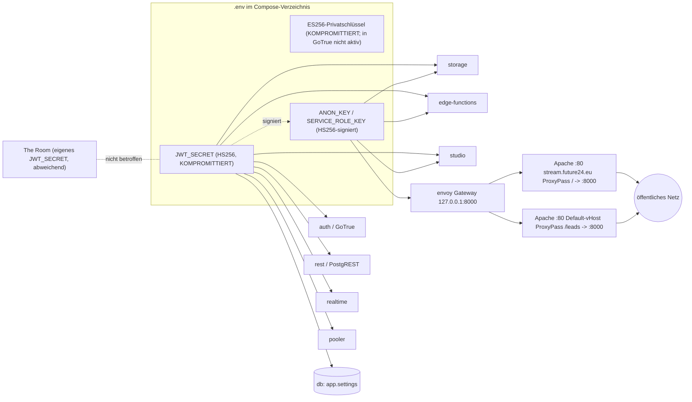

# F6 — Abhängigkeitsgraph der Supabase-Signaturschlüssel (Stand 2026-11-27, live erhoben, nur Namen)

| Verbraucher | Befund | Quelle |
|---|---|---|
| 8 Supabase-Container | Variablennamen siehe `F6-ANALYSIS.md` | `docker inspect`, nur Namen |
| Dateien mit eingebettetem `ANON_KEY`/`SERVICE_ROLE_KEY` außerhalb des Compose-Verzeichnisses (`/opt`, `/home/jo`, `/var/www`, `/etc/apache2`, `/etc/nginx`, `/srv` auf Server B) | **keine** | Wertvergleich ohne Ausgabe der Werte, nur Dateinamen |
| Asymmetrische vorab signierte Schlüssel | nicht gesetzt | `.env`-Namen |
| Server A (Studio, App-Toolchain) | keine App-Quelle mit Supabase-Variablen; nur Caches/Logs | rekursive Namenssuche |
| **Öffentliche Erreichbarkeit** | Gateway antwortet auf Server B über Apache :80 (`stream.future24.eu`, `/leads` am Default-vHost) mit Supabase-`401` | HTTP-Probe ohne Zugangsdaten vom Server selbst; externe Firewall `unverified` |
| Nicht lesbar für diese Sitzung | root-eigene Verzeichnisse, Container-Volumes, Browser-Clients Dritter | → Restrisiko `UNVERIFIED` |
